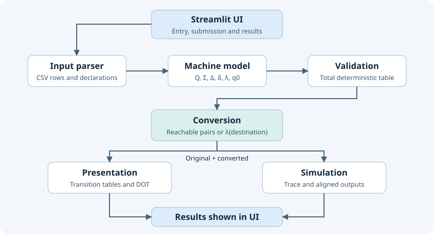

# System architecture

| Module | Responsibility |
|---|---|
| UI · app.py | Select direction and sample or custom machine, show results and compare traces |
| Parser · src/parser.py | Parse human-entered rows; detect malformed and duplicate entries before mapping keys |
| Model · src/models.py | Store Q, Σ, Δ, δ, λ, q0 and the machine kind |
| Validation · src/validator.py | Require complete deterministic coverage and declared states and symbols |
| Conversion · src/mealy_to_moore.py and src/moore_to_mealy.py | Build the target machine and preserve pair metadata for Mealy → Moore |
| Presentation · src/visualization.py | Format tables and DOT, with safe internal node identifiers |
| Simulation · src/simulator.py | Run both machines on identical tokens and align the output lists |
| Tests · tests/ | Check fixtures, validation, state generation, traces and the UI path |

The prototype runs in one local Streamlit process. Session memory holds the submitted conversion for simulation. The converters and simulator consume validated model objects and have no UI dependency.
