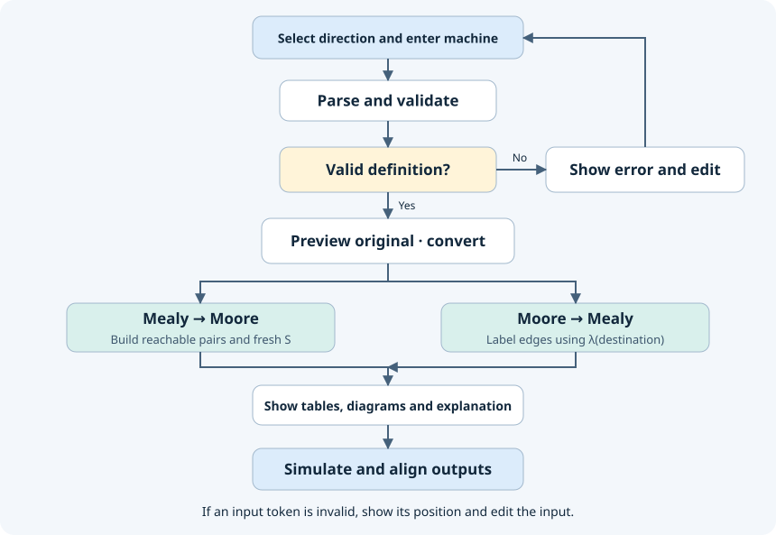

# Simulator workflow

A failed definition stays in the entry form with an error message. The prototype combines validation, original preview and conversion in one submission. The testing area allows repeated runs and handles invalid input symbols independently of machine validation.
