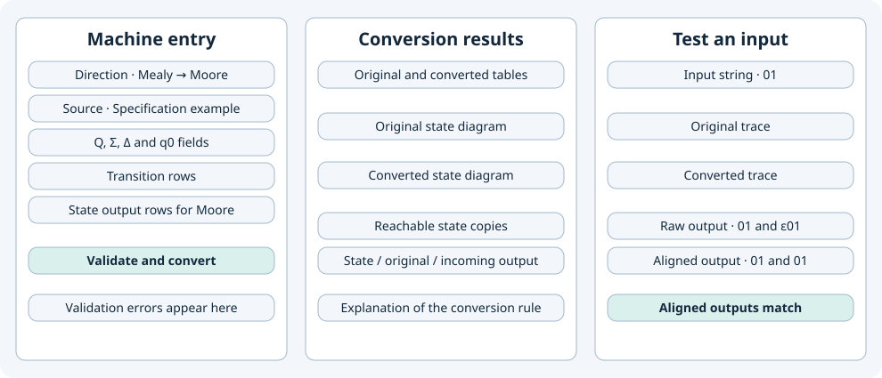

# UI wireframes

The three views follow the student's task order. The intended entry view uses a table, with one row per transition and a separate Moore output list. The prototype represents those rows as editable CSV text. Results show the initial state, transition tables, state diagrams and the conversion rule. The testing view keeps raw tokens and aligned tokens visible together, including the first Moore entry that was excluded.
